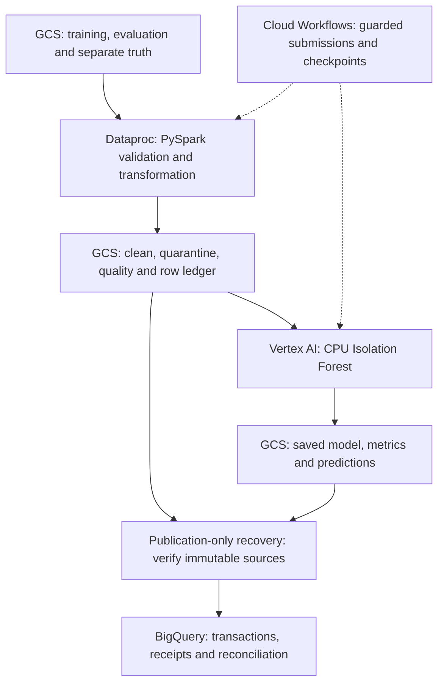

# GCP Intelligent Data Quality & Anomaly Detection Platform

A Python and PySpark pipeline for synthetic financial transactions. It validates
records, separates invalid data from statistical anomalies, evaluates Isolation
Forest against explicit rules, and publishes reconciled results to BigQuery.

**Cloud pilot verified on 2 November 2026:** Dataproc processed both input splits,
Vertex produced verified model and prediction artifacts, and a separate
publication-only recovery populated all six BigQuery tables. **The previous
Cloud Workflows executions and Vertex CustomJobs remain FAILED.** A successful
complete Workflows execution has not been demonstrated.

## Browse the inputs and outputs

Start with the [10-record walkthrough](examples/README.md). These are small
exports from the verified cloud artifacts, with matching transaction IDs across
inputs, cleaned data and predictions.

| Example | What to expect |
|---|---|
| [Input transactions](examples/input_transactions.csv) | 10 synthetic records; no truth labels in model inputs |
| [Cleaned output](examples/cleaned_transactions.csv) | The same 10 records with normalized timestamps, USD amounts and dates |
| [Quality results](examples/data_quality_results.csv) | All 12 checks for the full 100-row evaluation split; zero failures |
| [Validation summary](examples/validation_summary.json) | Source counts, sample bounds and export consistency checks |
| [Anomaly predictions](examples/anomaly_predictions.csv) | 10 saved scores, rules/ML/combined flags and evaluation truth |
| [Actual evaluation metrics](examples/evaluation.json) | Full 100-row metrics and confusion matrices |
| [Source provenance](examples/provenance.json) | Pinned generations, hashes, selected IDs and exported columns |

The sample deliberately includes detector mistakes, so it overrepresents
anomalies. The published metrics describe the full evaluation split, not these
10 rows. See [verified cloud results](docs/cloud-pilot-results.md) for publication
receipts and the limits of the recovery evidence.

## Verified GCP results

Project: `gcp-intelligent-data-quality` · Region: `asia-south1`

Source run: `workflow-smoke-002` · Dataset: `synthetic_quality_lakehouse`

Both Dataproc batches succeeded: 256 training records and 100 evaluation records,
with no quarantined records. Vertex trained the CPU Isolation Forest, saved it,
verified its reload, and wrote 100 predictions. The CustomJob then failed during
BigQuery publication because the original per-script billing limit was too low.

Publication-only recovery reused those exact artifacts with a **512 MiB limit
per script**. It restarted no Spark or Vertex work. All three publication
transactions committed, and independent read-back confirmed these counts:

| BigQuery table | Rows |
|---|---:|
| clean_transactions | 356 |
| quarantined_records | 0 |
| quality_results | 24 |
| pipeline_runs | 2 |
| anomaly_predictions | 100 |
| model_runs | 1 |

Source-to-target rows, receipt identities and artifact hashes matched. There were
no duplicate records. All 58 pinned GCS references were verified, including the
52 preserved run-001/run-002 evidence objects. The recovery queries reported
**450 MiB billed bytes**; actual invoiced cost is unavailable.

The local recovery wrapper reached its 900-second deadline during a repeated
final GCS check, after the publication jobs had committed. Independent
verification and a subsequent read-only check confirmed successful publication,
reconciliation and no active BigQuery jobs. This is a verified recovery result,
not a successful Workflows execution. Full job IDs, hashes and verification
boundaries are recorded in [cloud pilot results](docs/cloud-pilot-results.md).

## Actual model metrics

The cloud evaluation split has 100 transactions and five anomaly labels. Truth
labels were kept separate from training inputs.

| Detector | Precision | Recall | F1 |
|---|---:|---:|---:|
| Rules | 1.0000 | 1.0000 | 1.0000 |
| Isolation Forest | 0.2500 | 0.2000 | 0.2222 |
| Rules OR Isolation Forest | 0.6250 | 1.0000 | 0.7692 |

Rules performed better on this small synthetic split. The Isolation Forest's
low recall is a measured model limitation, not an unresolved publication error.
The [older local example](reports/examples/evaluation.json) uses a different
1,000-row evaluation split; its metrics should not be compared as the same run.

## Architecture



Inputs, packages and outputs use pinned generations and SHA-256 hashes. GCS
writes are create-only. Spark records each source row's identity, disposition
and payload hash so publication can reconcile rows rather than just totals.

Recovery has its own immutable attempt identity and deterministic BigQuery job
IDs. It reuses successful load jobs only when their configurations match, then
commits data and run receipts together. Replays reconcile existing jobs and
receipts; failed jobs are preserved rather than replaced. Atomicity is per
publication script, not across all three scripts.

Recovery reads allow at most two attempts for transient network/service errors,
with explicit connection/read timeouts. Generation, checksum and permission
failures stop immediately. The recovery path does not train models, submit
managed compute jobs or write GCS objects. **Do not rerun the completed recovery
to obtain a new local report.** Inspect its existing jobs and receipts instead.

## Run locally

Python 3.11 or newer is required. From the repository root on Linux/macOS:

```bash
python3 -m venv .venv
.venv/bin/python -m pip install -e '.[dev]'
.venv/bin/python -m synthetic_quality.pipeline --output-dir .tmp/local-example
.venv/bin/python -m pytest tests -q
```

On Windows, use `.venv\Scripts\python.exe` for the corresponding commands.
The local pipeline generates 5,000 normal training records and 1,000 independent
evaluation records with 50 injected anomalies. It exports data-quality reports,
a saved model, predictions and evaluation metrics. Use a fresh output directory
to preserve previous results.

Preprocessing, categories and thresholds are fitted on training data only.
Isolation Forest uses 200 trees, 256 sampled rows per tree, seed 42, one worker
and `contamination=0.02`. Evaluation labels never enter model fitting. Scores
are anomaly scores, not probabilities. Saved joblib models must come from a
trusted source.

## Tests

The final offline suites passed **443 tests**:

| Suite | Passed |
|---|---:|
| Core Python application | 164 |
| Dataproc and BigQuery | 65 |
| Vertex AI | 62 |
| Workflows and publication recovery | 152 |

Tests cover real local Spark/scikit-learn processing, bootstrap serialization,
strict resource identity checks, SQL rollback and reconciliation, deterministic
job replay, conflicting attempts, duplicate prevention and bounded GCS reads.
Cloud API boundaries are mocked in offline tests; cloud execution evidence is
reported separately above. Ruff lint and formatting checks also pass.

For feature tests, use a separate environment with Java 21 and the existing
feature dependencies:

```bash
python -m pip install -e '.[dev]' -r requirements-lakehouse.txt
python -m pytest -c tests_lakehouse/pytest.ini tests_lakehouse -q
python -m pytest -c tests_vertex/pytest.ini tests_vertex -q
python -m pytest -c tests_workflows/pytest.ini tests_workflows -q
python -m ruff check src tests tests_lakehouse tests_vertex tests_workflows tools jobs
python -m ruff format --check src tests tests_lakehouse tests_vertex tests_workflows tools jobs
```

GitHub Actions runs credential-free checks. CI success does not deploy or execute
GCP workloads. Bulk generated data, model binaries, credentials, temporary reports and
private cloud logs are excluded from Git. The small reviewed `examples/` exports
are intentionally included for browsing.

## Guides

- [Cloud pilot results and recovery evidence](docs/cloud-pilot-results.md)
- [Dataproc and BigQuery](lakehouse/README.md)
- [Vertex AI packaging, training and publication](vertex/README.md)
- [Workflows deployment and recovery runbook](workflows/README.md)
- [GCP foundation and Cloud Run preparation](docs/gcp-phase1.md)
- [Historical local verification](docs/verification.md)

## Known limitations

- Full managed Workflows success is still unverified. Previous failed executions,
  jobs and reservations remain preserved. Future executions need a separately
  reviewed plan/package identity; blindly resuming the old run is unsafe.
- The recovery CLI's repeated final reads can outlast its wrapper deadline.
  A timeout does not cancel BigQuery jobs or prove that publication failed.
- External Scheduler/Eventarc/Cloud Asset trigger inventory remains unverified;
  no triggers or schedules were introduced by recovery.
- Cloud Run Job execution remains unverified; it is a separate optional path.
- Synthetic data, one small evaluation split and simple injection mechanisms do
  not establish production fraud detection, throughput or reliability. Separate
  calibration/holdout splits, repeated-seed evaluation and realistic temporal
  behavior remain future work.
