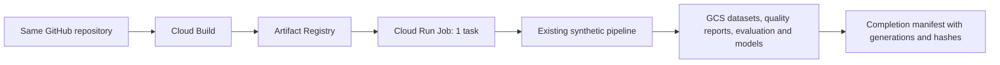
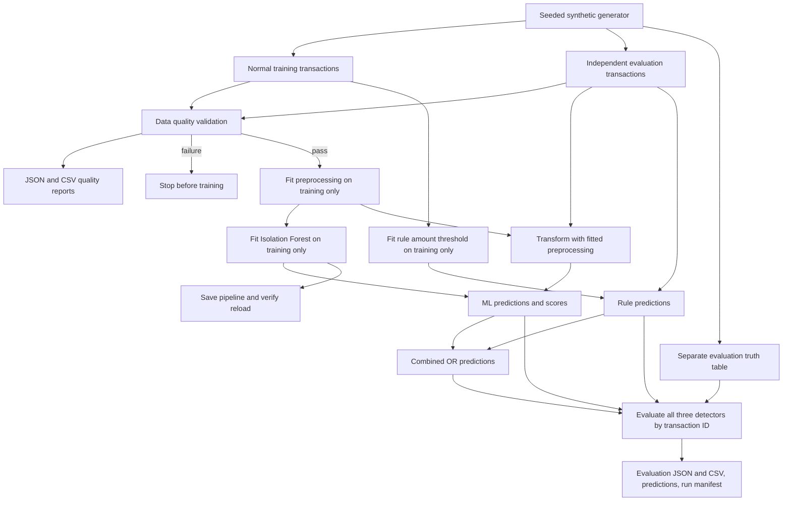

# ML-Based Synthetic Data Quality & Anomaly Detection

A reproducible Python workflow for validating synthetic financial transactions,
detecting statistical anomalies, and comparing an Isolation Forest with explicit rules.
**The original pipeline is verified; the Phase 1 GCP extension is implemented and
tested offline in Codex Cloud, with live GCP deployment pending approval.** This is a
portfolio engineering project, not a validated fraud detection product.

The default experiment generates 5,000 normal training transactions and 1,000 independent
evaluation transactions with 50 injected anomalies. It validates both datasets, trains
without evaluation labels, saves a reusable model, and exports auditable reports.

## Phase 1 GCP platform

The new finite `synthetic-quality-cloud` entry point reuses the original `run_pipeline`
without modifying its generation, validation, model or evaluation logic. Cloud Build
is prepared to publish a CPU container to Artifact Registry; a Cloud Run **Job** will
run it once using a dedicated keyless service account. The job stages outputs in a
temporary container directory, uploads 12 allowlisted artifacts to GCS, and writes an
immutable completion manifest last.



Uploads use `if_generation_match=0` and generation-pinned read-back verification.
Retries preserve existing objects, resume matching partial runs, and verify completed
runs without retraining. Configuration/source/runtime conflicts fail rather than
overwrite. Run IDs and dataset sizes are configurable through CLI flags or environment
variables; sizes are capped at 100,000 rows per split. Raw datasets, quality reports,
evaluation reports, models and run manifests have separate GCS prefixes.

Start with the [GCP deployment guide](docs/gcp-phase1.md) for the complete configuration
table, object layout, required APIs and minimum IAM, remote build/deployment commands,
256/100-row smoke test, cost-control checklist and cleanup. The proposed region is
Mumbai (`asia-south1`), subject to current service/project compatibility checks.
Development and tests run in hosted Codex Cloud; future managed executions run on GCP.
**No GCP resources have been created or jobs executed.** Billing/spending controls and
explicit approval are required before any live provisioning, build or execution.

[Verification evidence](docs/verification.md) distinguishes hosted-Codex checks from
unverified live GCP behavior. GitHub Actions runs credential-free tests, Ruff checks,
dependency checks, and a 94.5% coverage floor. The original Windows dependency snapshot
and measured ML results below are retained.

## Business problem and objectives

Transaction pipelines need to distinguish invalid records from valid but unusual events.
A missing currency or negative amount is a data contract failure; an unusually large,
positive payment can be valid data deserving investigation. Mixing these problems can
make anomaly metrics misleading.

This project demonstrates reproducible generation, explicit data contracts, separation
of training and evaluation, leakage prevention, model persistence, and honest comparison
against a simple baseline. The baseline wins this experiment; that finding is retained
as evidence rather than hidden behind an ML-only result.

## Architecture



Technology: Python 3.11+, NumPy, pandas, scikit-learn, joblib, Pytest,
pytest-cov, and Ruff, with the official `google-cloud-storage` client in the optional
`cloud` extra. The original workflow was verified on **Windows x64 / Python 3.13.0**;
the extension is verified on **Linux / Python 3.12 in Codex Cloud**. The original CLI
still runs offline without cloud dependencies. The cloud entry point requires GCS
and Application Default Credentials supplied by its runtime service account.

## Local installation: Windows PowerShell and VS Code

These retained instructions describe the original standalone workflow. Current
development/testing takes place in Codex Cloud; use the deployment guide for the GCP
extension and do not execute managed pipelines on a laptop.

Open this repository folder in VS Code. Use a Python 3.11 or newer interpreter;
Python 3.13 is recommended for reproducing the checked-in example reports.
Run from the repository root:

```powershell
python --version
New-Item -ItemType Directory -Path .tmp -Force | Out-Null
$env:TEMP = Join-Path (Get-Location) '.tmp'
$env:TMP = $env:TEMP
$env:PIP_CACHE_DIR = Join-Path (Get-Location) '.tmp\pip-cache'
python -m venv .venv
.\.venv\Scripts\python.exe -m pip install -e '.[dev]' -c requirements-lock.txt
```

The temporary-directory settings keep installation scratch files and caches in this
project and avoid restricted Windows temp-directory permissions. They affect only
the current PowerShell session. Activation is unnecessary: using the environment's
Python directly avoids PowerShell activation-policy changes.

`pyproject.toml` declares dependencies. `requirements-lock.txt` pins the installed
runtime and development packages used for the verified Python 3.13 run; it is a
constraints snapshot, not a cross-platform or hash-verified lock. On Python 3.11/3.12,
or if those exact wheels are unavailable, use the compatible ranges instead:

```powershell
.\.venv\Scripts\python.exe -m pip install -e '.[dev]'
```

Other Python/library combinations have not been tested here and can produce different
model metrics. VS Code settings select `.venv/Scripts/python.exe` and enable Pytest
discovery; choose that interpreter manually if VS Code already has another selection.

## Run the complete workflow

```powershell
.\.venv\Scripts\python.exe -m synthetic_quality.pipeline
```

After activating the environment, the equivalent command is
`python -m synthetic_quality.pipeline`; the installed `synthetic-quality` command also
uses the same entry point.

The default command writes `data/`, `models/`, and `reports/` under the current working
directory. Rerunning overwrites generated files with those names. Use a new output
directory to preserve an earlier experiment:

```powershell
.\.venv\Scripts\python.exe -m synthetic_quality.pipeline --output-dir .tmp\experiment
.\.venv\Scripts\python.exe -m synthetic_quality.pipeline --help
```

Model options are `--n-estimators` (200), `--max-samples` (256),
`--contamination` (0.02), and `--model-seed` (42). For programmatic configuration,
use the `PipelineConfig` and `ModelConfig` dataclasses. Training and evaluation
seeds must differ. Changing settings creates a different experiment; do not compare
it to the checked-in results as if it were the same run.

## Dataset and ground truth

| Split | Rows | Seed | UTC period | Injected anomalies |
|---|---:|---:|---|---:|
| Training | 5,000 | 42 | January 1–28, 2025 | 0 |
| Evaluation | 1,000 | 123 | February 1–28, 2025 | 50 (5%) |

Each transaction has exactly these seven columns:

| Column | In-memory contract |
|---|---|
| `transaction_id` | Unique, nonempty string; split/seed/row identifier |
| `customer_id` | Nonempty string; one of 500 possible synthetic customers per split |
| `timestamp` | Non-null pandas datetime with UTC timezone |
| `transaction_amount` | Finite positive real number in nominal transaction currency |
| `merchant_category` | groceries, dining, retail, transport, entertainment, utilities |
| `currency` | USD, GBP, EUR, INR |
| `country` | US, GB, DE, IN, paired with USD, GBP, EUR, INR respectively |

Normal USD-equivalent amounts follow a lognormal distribution with log mean 3.7,
log standard deviation 0.8, and a minimum of 1. Normal hours span 07:00–22:59 UTC.
The generator uses a local `numpy.random.Generator`; it does not reset global state.
Training/evaluation have different random seeds, disjoint IDs, and disjoint periods.

Exactly `round(n_rows * anomaly_fraction)` randomly chosen rows are labeled as
injected. At default settings, 25 receive amounts sampled uniformly from 2,000–5,000
USD equivalent; 25 receive times between 00:00 and 04:59 UTC. Injection labels
describe the intervention, not a guarantee that a particular detector will flag it.
Amounts remain positive and timestamps remain valid, so statistical anomalies pass
data quality validation.

Fixed illustrative rates are 1 USD = 0.8 GBP = 0.9 EUR = 80 INR. These are simulation
constants, not current market rates. Both generation and feature engineering use
the same constants; nominal amounts are rounded to two decimal places.

`evaluation_truth.csv` contains only `transaction_id`, `is_anomaly`, and
`injection_type`. It is separate from transaction inputs. Evaluation joins truth by
ID, so a reordered truth table does not change metrics. Invalid quality fixtures
exist only in tests; they are never mixed into the anomaly evaluation dataset.

## Data quality checks

Every result includes `check_name`, `failure_count`, `details`, `skipped_columns`,
and `passed`. The full report also includes row count and overall status.

| Check | Failure-count unit |
|---|---|
| Schema mismatch | Missing, unexpected, or repeated column names |
| Missing required columns | Missing columns |
| Empty dataset | One failure for zero rows |
| Null values | Null cells in required columns |
| Duplicate transaction IDs | Non-null duplicate occurrences after the first |
| Invalid amounts | Non-null, nonnumeric, nonfinite, zero, or negative amounts |
| Invalid data types | Non-null cells incompatible with the contract |
| Unsupported currencies | Non-null currency values outside the supported set |
| Business rules | Rows violating at least one rule |

Business rules enforce nonblank identifiers/categories/countries/currencies,
supported categories/countries, the country–currency mapping, and UTC timestamps.
Native numeric amounts are required: a string such as `"23.50"` fails the type check
even if numeric parsing is possible. CSV timestamps must be explicitly parsed.
Missing fields are named in dependent checks' `skipped_columns`; a zero count there
does not mean the unavailable field was inspected. Overall validation still fails.

Counts across checks overlap and must not be summed to estimate bad rows.
Validation does not mutate, drop, or silently repair records. The workflow writes
quality reports and raises on failure before training. Review artifacts only from
a successful run; older files in a reused output directory can remain after a failure.

## Features and machine learning

The fitted scikit-learn pipeline contains:

1. An explicit feature allowlist: log(1 + USD-equivalent amount), sine/cosine of
   fractional UTC hour, merchant category, currency, and country.
2. Training-fitted median imputation and standard scaling for numeric features.
   Scaling is not required for tree splits, but provides a consistent numeric
   representation. Categorical values use constant imputation and dense one-hot
   encoding, with unknown categories ignored. The default matrix has 17 columns.
3. Isolation Forest with 200 trees, 256 sampled rows per tree, random state 42,
   one worker, and `contamination=0.02`.

All learned preprocessing, categories, and thresholds use training data only.
IDs, labels, injection types/flags, and arbitrary extra columns are ignored by
the feature extractor. Tests verify that adding malicious target columns cannot
change the feature matrix or fitted model's predictions.

Missing feature columns and unseen categories can be transformed safely by the
reusable preprocessor. The complete experiment still enforces the strict data
contract first; imputation is not a substitute for quality checks. Feature extraction
is entirely row-local. No frequency or aggregate customer features are implemented,
so predictions cannot use future transactions or depend on batch ordering.

The 2% contamination setting sets a training-score cutoff; it is an alert-budget
assumption, not a claim that the normal-only training data contain 2% actual anomalies,
and it does not force 2% or 5% of evaluation records to be flagged. Predictions map
scikit-learn's `-1` to **1 = anomaly**, and `+1` to **0 = normal**. Scores are
`-decision_function`: larger means more anomalous, with scores strictly above zero
flagged. Scores are not probabilities.

The rule baseline flags amounts above the training 99.5th percentile
(316.572525625 USD equivalent in this run) **or** hours before 06:00 UTC.
The combined detector is the logical OR of rules and ML, representing a policy
that accepts an alert from either detector. It is not a calibrated ensemble.

## Evaluation methodology and actual results

All three detectors score the same 1,000 evaluation transactions. Anomaly is the
positive class. Precision is TP/(TP+FP), recall is TP/(TP+FN), and F1 is the harmonic
mean of precision and recall. Undefined zero-denominator metrics are reported as
zero. Confusion matrices use `[[TN, FP], [FN, TP]]`.

The generator, features, and default detector settings were specified before the
first evaluation and retained afterward. Evaluation truth is never supplied to
training or threshold fitting. No holdout-driven tuning or dataset adjustment was
performed. There is one fixed synthetic evaluation split, not a validation/test
search protocol.

Measured locally on October 28, 2026, with the dependency snapshot in
`requirements-lock.txt`:

| Detector | Precision | Recall | F1 | Actual anomalies | Predicted anomalies | FP | FN |
|---|---:|---:|---:|---:|---:|---:|---:|
| Rule baseline | 0.9091 | 1.0000 | 0.9524 | 50 | 55 | 5 | 0 |
| Isolation Forest | 0.3182 | 0.1400 | 0.1944 | 50 | 22 | 15 | 43 |
| Combined OR | 0.7143 | 1.0000 | 0.8333 | 50 | 70 | 20 | 0 |

Confusion matrices: rules `[[945, 5], [0, 50]]`; Isolation Forest
`[[935, 15], [43, 7]]`; combined `[[930, 20], [0, 50]]`.
Isolation Forest detects 4/25 high-amount injections and 3/25 unusual-time
injections. The rules detect all 25 of each. Combined OR adds 15 false positives
over the rules without increasing recall in this experiment.

These results do **not** establish that ML outperforms rules. The rules directly
encode this simulator's anomaly mechanisms, which favors them. Isolation Forest
learns partitions from normal data; values beyond normal support are not guaranteed
to receive sufficiently short paths. Feature representation, redundant
country/currency indicators, rare categories, and the threshold are plausible
contributors to poor recall, but their effects have not been isolated experimentally.
Any next model experiment needs a separate calibration/validation split before a
new untouched test set is evaluated.

Full-precision examples are checked in at
[`reports/examples/evaluation.json`](reports/examples/evaluation.json) and
[`reports/examples/evaluation.csv`](reports/examples/evaluation.csv), alongside
quality reports and a run manifest with configuration, versions, feature names,
dataset SHA-256 hashes, and saved-model reload verification.

## Reuse the saved model

Run the workflow once, then execute this Python code from the repository root:

```python
import pandas as pd
from synthetic_quality.model import load_model, predict_anomalies
from synthetic_quality.quality_checks import validate_transactions

transactions = pd.read_csv("data/evaluation.csv")
transactions["timestamp"] = pd.to_datetime(transactions["timestamp"], utc=True)
validate_transactions(transactions).raise_for_errors("reloaded evaluation")
model = load_model("models/isolation_forest.joblib")
predictions = predict_anomalies(model, transactions)
print(predictions.labels[:10])
print(predictions.scores[:10])
```

The joblib file contains both fitted preprocessing and Isolation Forest. Every
pipeline run reloads it and checks exact label/score equality. Only load trusted
joblib files: pickle-based loading can execute code. Use the same dependency
versions as the model's metadata. The baseline threshold is also saved as JSON;
it can be restored with `RuleBaseline(**json.load(file))`.

## Tests and verification

```powershell
.\.venv\Scripts\python.exe -m pytest -q
.\.venv\Scripts\python.exe -m pytest -q --cov=synthetic_quality --cov-report=term-missing
.\.venv\Scripts\python.exe -m ruff check src tests
.\.venv\Scripts\python.exe -m ruff format --check src tests
.\.venv\Scripts\python.exe -m pip check
```

The original suite executed **82 tests: 82 passed, 0 failed**, reconfirmed before the
cloud changes at **94.5%** coverage with branch measurement enabled. The new cloud
suite additionally exercises real generation/training with fake GCS storage and no
GCP credentials or paid API calls; see [current exact results](docs/verification.md).
The original CLI subprocess is exercised by a real process,
but its lines are not included in parent-process coverage. This is measured coverage,
not a guarantee of correctness or real-world detection accuracy.

Tests cover generation seeds/sizes/schema/labels, independent splits, invalid data
fixtures, nulls/types/currencies/business rules, safe missing-feature transformation,
unchanged training statistics after evaluation, label leakage, row-local features,
reproducible fitting, binary predictions/scores, persistence, hand-calculated metrics,
baseline thresholds, truth alignment, fail-fast validation, and the documented CLI.
Two full default runs are compared for identical data, predictions, reports, and
hashes. Reproducibility is established within the tested environment, not promised
bit-for-bit across Python/library releases or hardware.

To keep test temporary files inside the project in a fresh shell, set `TEMP` and
`TMP` as in installation, or add `--basetemp .tmp\pytest` to the Pytest command.
Pytest clears its selected base temporary directory: reserve that path for tests.

## File inventory

```text
.
├── .gitattributes
├── .gitignore
├── .vscode/
│   ├── extensions.json
│   └── settings.json
├── pyproject.toml
├── requirements-lock.txt
├── requirements-cloud.txt    # tested Linux/Python 3.12 runtime version pins
├── Dockerfile               # non-root finite CPU job
├── .dockerignore
├── .gcloudignore
├── cloudbuild.yaml          # remote build/push only; no deploy/execute
├── .github/workflows/ci.yml  # credential-free checks
├── docs/
│   ├── gcp-phase1.md         # architecture, configuration, IAM, cost and deployment
│   └── verification.md      # exact evidence and live-cloud limitations
├── README.md
├── src/synthetic_quality/
│   ├── __init__.py
│   ├── cloud_config.py       # bounded environment/CLI config and safe object paths
│   ├── cloud_job.py          # request, existing pipeline, artifacts, completion
│   ├── gcs.py                # create-only GCS adapter and read-back verification
│   ├── schema.py             # data contract and simulation constants
│   ├── data_generator.py     # independent seeded datasets and separate truth
│   ├── quality_checks.py     # non-mutating structured validation
│   ├── features.py           # allowlisted row-local sklearn preprocessing
│   ├── model.py              # train, score, save, load
│   ├── baseline.py           # training-calibrated explicit rules
│   ├── evaluation.py         # binary metrics and JSON/CSV writers
│   └── pipeline.py           # orchestration and command-line entry point
├── tests/
│   ├── conftest.py
│   ├── test_cloud_config.py
│   ├── test_cloud_job.py
│   ├── test_data_generator.py
│   ├── test_quality_checks.py
│   ├── test_features.py
│   ├── test_model.py
│   ├── test_baseline.py
│   ├── test_evaluation.py
│   └── test_pipeline.py
├── data/.gitkeep
├── models/.gitkeep
└── reports/
    ├── .gitkeep
    └── examples/
        ├── data_quality.json
        ├── data_quality.csv
        ├── evaluation.json
        ├── evaluation.csv
        ├── run_manifest.json
        └── verification.json
```

Generated, ignored artifacts are `data/training.csv`, `data/evaluation.csv`,
`data/evaluation_truth.csv`, `models/isolation_forest.joblib`,
`models/model_metadata.json`, `models/rule_baseline.json`, and the reports
`data_quality.json`, `data_quality.csv`, `evaluation.json`, `evaluation.csv`,
`predictions.csv`, and `run_manifest.json`. Verification can additionally produce
`reports/coverage.json` and `reports/pytest.xml`. `.venv/`, caches, build metadata,
temporary files, generated datasets, and binary models are excluded from Git.

## Limitations and future enhancements

Implemented Phase 1 covers the original workflow plus a GCP-ready execution layer.
It does not demonstrate real fraud detection, production throughput, or verified
live cloud deployment. GCP IAM, ADC, regional availability, resource sizing and costs
remain unverified until the approved deployment smoke test.
The small synthetic population has simplified independent categories/amounts,
fixed currency relationships, artificial UTC spending hours, no seasonal or
customer behavior, and only two conspicuous anomaly types. A single evaluation
seed provides limited statistical evidence. Synthetic injection truth is not
expert-reviewed fraud truth. The low Isolation Forest recall remains an explicit
model limitation, not an unresolved execution error.

Planned, **not implemented**: separate calibration and holdout splits; repeated-seed
evaluation; controlled feature ablations and threshold analysis; realistic temporal
and customer histories with past-only frequency windows; drift/monitoring;
MLflow experiment tracking; automated deployment; and larger-scale PySpark and
advanced SQL workflows. Dataproc, BigQuery, Vertex AI and Cloud Workflows are outside
this phase. Credential-free CI is implemented; deployment remains manual and gated.

## Review and publication

Changes stay in the existing
[ml-synthetic-data-quality repository](https://github.com/chandrakanth02512-ctrl/ml-synthetic-data-quality)
on a feature branch for pull-request review; merging is a separate action. Generated
datasets/models, credentials, and test outputs must remain outside Git. Existing small
example reports are retained as historical evaluation evidence. Publishing source or
passing CI does not authorize GCP deployment or establish live-cloud verification.
