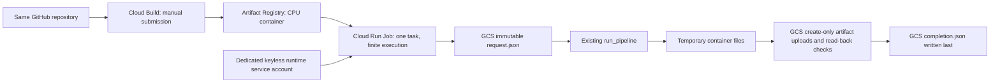

# Phase 1: GCP execution preparation

**Prepared and tested in hosted Codex Cloud; not deployed or verified on GCP.**
No APIs have been enabled, resources created, Cloud Builds submitted, or Cloud Run
Jobs executed as part of this change. Existing ML behavior and example results are
retained, including Isolation Forest recall of **0.1400** in the original experiment.

## Architecture and resource boundary



There is no HTTP service, scheduler, Dataproc, BigQuery, Vertex AI, or Workflows.
Cloud Build builds and pushes only; deployment and execution are separate manual
steps. Development and offline tests run in Codex Cloud. All future managed pipeline
executions run on GCP, never on the user's laptop. Cloud Shell is suitable for the
future deployment commands below; do not run the pipeline there as a substitute for
Cloud Run Jobs.

Proposed resources, all in one explicitly selected project:

| Resource | Small initial configuration |
|---|---|
| Artifact Registry | One private Docker repository; tagged revisions, deploy by digest |
| GCS data bucket | Regional Standard, uniform access, public access prevention |
| GCS build-source bucket | Separate private regional bucket for source staging |
| Cloud Build | Manual default worker, 1,200-second timeout; no trigger |
| Cloud Run Job | 1 task, parallelism 1, 1 vCPU, 1 GiB, 600-second timeout, 0 automatic retries |
| Service accounts | Separate build and runtime identities; no key files |

`asia-south1` (Mumbai) is **a proposal**, not a verified project deployment location.
Before creating resources, check current [Cloud Run locations](https://cloud.google.com/run/docs/locations),
[Cloud Build locations](https://cloud.google.com/build/docs/locations),
[Artifact Registry locations](https://cloud.google.com/artifact-registry/docs/repositories/repo-locations),
and [GCS locations](https://cloud.google.com/storage/docs/locations). Confirm availability
for Jobs, regional builds, repository and bucket, the project's quotas and organization
policies, and colocate all four. If incompatible, stop and agree another region; do
not silently use a different location.

## Configuration

Install the optional cloud extra in the Codex development environment:

```bash
python -m pip install -e '.[cloud,dev]' -c requirements-cloud.txt -c requirements-lock.txt
python -m synthetic_quality.cloud_job --help
```

The module entry point and installed `synthetic-quality-cloud` command are equivalent.
CLI flags override environment variables. Empty values are errors, not fallbacks.

| Environment variable | CLI flag | Default / allowed value |
|---|---|---|
| `GCP_PROJECT_ID` | `--project-id` | Required GCP project ID |
| `GCS_BUCKET` | `--bucket` | Required bucket name, without `gs://`; 3–63 lowercase letters/digits/hyphens |
| `RUN_ID` | `--run-id` | Required deterministic identifier; 1–64 letters/digits/underscores/hyphens, starts alphanumeric |
| `GCS_PREFIX` | `--prefix` | `synthetic-quality`; relative slash-separated alphanumeric/underscore/hyphen segments, max 200 characters |
| `TRAINING_ROWS` | `--training-rows` | `5000`; integer 1–100000 |
| `EVALUATION_ROWS` | `--evaluation-rows` | `1000`; integer 1–100000 |
| `TRAINING_SEED` | `--training-seed` | `42`; integer 0–4294967295 |
| `EVALUATION_SEED` | `--evaluation-seed` | `123`; same range, different from training seed |

An explicit run ID such as `smoke-001` remains stable across retries. No wall-clock
timestamp or random execution ID is substituted. Model settings and anomaly fraction
retain the verified `PipelineConfig` defaults (200 trees, one worker, 5% evaluation
injections). Temporary directories are removed on normal completion and exceptions;
container destruction cleans up after forced termination. Container files count
against memory in Cloud Run. The row cap is a guardrail, not a capacity guarantee;
start at 256/100 rows and assess memory/time before increasing.

Only synthetic generation is supported. There is no input-file or external dataset
parameter. The explicit artifact allowlist excludes credentials and arbitrary files.

## Object layout and retry contract

```text
gs://BUCKET/PREFIX/
  raw-data/RUN_ID/{training.csv,evaluation.csv,evaluation_truth.csv}
  quality-reports/RUN_ID/{data_quality.json,data_quality.csv}
  evaluation-reports/RUN_ID/{evaluation.json,evaluation.csv,predictions.csv}
  models/RUN_ID/{isolation_forest.joblib,model_metadata.json,rule_baseline.json}
  run-manifests/RUN_ID/{request.json,run_manifest.json,completion.json}
```

1. `request.json` reserves `(bucket, prefix, run_id)` for the exact configuration,
   package versions, Python version, and Python source digest. Every create uses
   `if_generation_match=0`; an existing key is never overwritten.
2. If a valid `completion.json` exists, verify all 12 artifact names, generations,
   sizes and SHA-256 hashes against current stored bytes, then exit without retraining.
   Modified configuration/source/runtime, malformed manifests, changed generations,
   missing artifacts or different bytes fail closed.
3. Otherwise regenerate using the same image and seeds in a fresh temporary directory.
   Upload missing artifacts; reuse existing artifacts only when their bytes match.
   The official GCS client retries transient requests with a 60-second retry budget
   per operation and a 30-second request timeout. Those budgets can be exceeded by an
   in-flight request; the job timeout is the outer bound. IAM/configuration failures
   are not disguised as successful retries.
4. Read back each object with its generation precondition and compare exact bytes.
   Read checksums remain enabled. Upload-side SDK checksum cleanup is disabled to
   avoid implicit deletion; application read-back verification catches corruption
   and preserves conflicting objects for operator inspection.
5. Write create-only `completion.json` **last**, with `status: complete`, the request
   identity, and every artifact's object key, generation, byte size and SHA-256 hash.

Consumers must require `completion.json`; `request.json` and the original pipeline's
`run_manifest.json` do **not** mean a cloud run completed. A lost completion-upload
acknowledgement can mean the job reports failure even though GCS has a valid completed
run; retrying the same run verifies it. Concurrent identical invocations converge on
the same objects/manifest; they may duplicate computation, not completed objects.

Partial failures leave an immutable request and any successfully uploaded artifacts,
with no new completion marker. Retry the **same image digest, configuration, prefix
and run ID**. A new image/library release requires a new run ID. The runtime never
deletes or repairs mismatches; an operator must inspect them and normally use a new
ID. This is a manifest commit protocol, not a multi-object GCS transaction. External
administrators/lifecycle policies can still delete or alter objects; completed-run
verification detects that damage but cannot prevent it. Read-back adds GCS operations
and transfer overhead, intentionally acceptable for these small experiments.

## Approval and cost gate before any live commands

All remaining provisioning/build/deploy/execute commands are **review material only**.
Obtain explicit approval before running anything that can create billable resources.
In Cloud Shell or an approved cloud executor, verify:

- Correct project ID, owner and active billing account; free-trial eligibility,
  remaining credits and expiry. Trial credit is not a guarantee of zero charges.
- Billing budgets and alert recipients/thresholds (for example 50%, 90%, 100%).
  **Budgets alert; they do not cap spending or automatically stop resources.**
- An agreed spending limit and manual shutdown procedure; quotas where supported.
- Current regional pricing, compatibility, IAM and organization policies.
- One manual build and one 256/100-row execution; no trigger, schedule, GPUs,
  always-on service, public bucket access, or downloaded service-account keys.
- Task count/parallelism/retries/timeouts and retention costs for data, images,
  build staging, logs, object versioning and soft delete. Review GCS's default
  soft-delete retention; deleted data can remain billable until retention expires.
- Cleanup owner and date; preserve only the evidence deliberately needed.

## APIs and IAM

Required APIs: `serviceusage.googleapis.com`, `iam.googleapis.com`,
`cloudbuild.googleapis.com`, `artifactregistry.googleapis.com`,
`run.googleapis.com`, `storage.googleapis.com`, `logging.googleapis.com`.
Enable `iamcredentials.googleapis.com` only if using service-account impersonation
or workload identity federation tooling that requires it. Interactive Cloud Shell
authentication or approved short-lived federation is sufficient; never create keys.

| Principal | Minimum task-specific access / scope |
|---|---|
| Runtime service account | Custom role with **only** `storage.objects.create` and `storage.objects.get`, bound on the data bucket. No list/delete/update, bucket admin, build or deploy permissions. |
| Build service account | `roles/artifactregistry.writer` on the selected repository; `roles/storage.objectViewer` on source-staging bucket; `roles/logging.logWriter` on project. No access to data bucket or job execution. |
| Cloud Run service agent | Google-managed `roles/run.serviceAgent`; pulls same-project images. Verify service-agent provisioning; never attach this role to the runtime identity. |
| Deployment operator | `roles/cloudbuild.builds.editor`, source-staging object upload/read permissions, `roles/run.developer`, and `roles/iam.serviceAccountUser` on the specific build/runtime accounts; read repository/image metadata to select digest. |
| Execution-only operator | `roles/run.invoker` on the job; job read/log read access to inspect results. Overrides require additional execution permissions; the documented smoke test uses no overrides. |
| Bootstrap administrator (temporary) | Enable APIs, create two buckets/repository/service accounts/custom role, and set narrowly scoped IAM bindings. Typical setup roles: serviceUsageAdmin, storage.admin, artifactregistry.admin, iam.serviceAccountAdmin, iam.roleAdmin and project IAM policy administration. Remove elevated setup access after provisioning. |

Predefined operator/build roles include permissions beyond individual calls; scope
them as narrowly as the service allows. Do not grant Owner/Editor to runtime/build
accounts. Cloud Run sends stdout/stderr to Logging without runtime Logging API calls.

## Future reproducible setup (do not run before approval)

Run from this same repository's reviewed commit in **Cloud Shell**, with `gcloud`
authenticated to the intended account. Choose globally unique bucket names and
validate every variable. Commands use explicit `--project` and regional flags;
no default project mutation is required.

```bash
export PROJECT_ID='replace-with-project-id'
export REGION='asia-south1'  # proposed; verify all service locations before proceeding
export DATA_BUCKET='replace-with-unique-data-bucket'
export SOURCE_BUCKET='replace-with-unique-build-source-bucket'
export REPOSITORY='synthetic-quality'
export IMAGE='synthetic-quality'
export JOB='synthetic-quality-phase1'
export PREFIX='synthetic-quality'
export RUN_ID='smoke-001'
export RUNTIME_ACCOUNT='synthetic-quality-runtime'
export BUILD_ACCOUNT='synthetic-quality-build'
export RUNTIME_SA="${RUNTIME_ACCOUNT}@${PROJECT_ID}.iam.gserviceaccount.com"
export BUILD_SA="${BUILD_ACCOUNT}@${PROJECT_ID}.iam.gserviceaccount.com"

# Read-only checks; do not proceed merely because billing is enabled.
gcloud projects describe "$PROJECT_ID"
gcloud billing projects describe "$PROJECT_ID"
```

After approval and the cost gate, a bootstrap administrator can run:

```bash
gcloud services enable serviceusage.googleapis.com iam.googleapis.com \
  cloudbuild.googleapis.com artifactregistry.googleapis.com run.googleapis.com \
  storage.googleapis.com logging.googleapis.com --project="$PROJECT_ID"

gcloud artifacts repositories create "$REPOSITORY" --repository-format=docker \
  --location="$REGION" --project="$PROJECT_ID"
gcloud storage buckets create "gs://${DATA_BUCKET}" --project="$PROJECT_ID" \
  --location="$REGION" --default-storage-class=STANDARD \
  --uniform-bucket-level-access --public-access-prevention
gcloud storage buckets create "gs://${SOURCE_BUCKET}" --project="$PROJECT_ID" \
  --location="$REGION" --default-storage-class=STANDARD \
  --uniform-bucket-level-access --public-access-prevention

gcloud iam service-accounts create "$RUNTIME_ACCOUNT" --project="$PROJECT_ID"
gcloud iam service-accounts create "$BUILD_ACCOUNT" --project="$PROJECT_ID"
gcloud iam roles create syntheticQualityObjects --project="$PROJECT_ID" \
  --title='Synthetic quality immutable objects' --stage=GA \
  --permissions=storage.objects.create,storage.objects.get
gcloud storage buckets add-iam-policy-binding "gs://${DATA_BUCKET}" \
  --member="serviceAccount:${RUNTIME_SA}" \
  --role="projects/${PROJECT_ID}/roles/syntheticQualityObjects"
gcloud artifacts repositories add-iam-policy-binding "$REPOSITORY" \
  --location="$REGION" --project="$PROJECT_ID" \
  --member="serviceAccount:${BUILD_SA}" --role=roles/artifactregistry.writer
gcloud storage buckets add-iam-policy-binding "gs://${SOURCE_BUCKET}" \
  --member="serviceAccount:${BUILD_SA}" --role=roles/storage.objectViewer
gcloud projects add-iam-policy-binding "$PROJECT_ID" \
  --member="serviceAccount:${BUILD_SA}" --role=roles/logging.logWriter
```

Grant the approved deployment operator `iam.serviceAccountUser` on **both** dedicated
accounts, build submission permissions and staging-bucket create/read access described
above. Verify the Google-managed Cloud Build/Cloud Run service agents and applicable
organization policies. Do not solve an access error by giving runtime broad project
permissions. If resources already exist, inspect ownership/settings and reuse them;
do not delete/recreate or change another project's resources to make a command pass.

Build remotely after explicit approval. `.gcloudignore` and `.dockerignore` allow
only application source and build metadata; inspect the upload list first:

```bash
gcloud meta list-files-for-upload
export IMAGE_TAG="$(git rev-parse HEAD)"
export IMAGE_URI="${REGION}-docker.pkg.dev/${PROJECT_ID}/${REPOSITORY}/${IMAGE}"
gcloud builds submit . --config=cloudbuild.yaml --project="$PROJECT_ID" \
  --region="$REGION" \
  --service-account="projects/${PROJECT_ID}/serviceAccounts/${BUILD_SA}" \
  --gcs-source-staging-dir="gs://${SOURCE_BUCKET}/source" \
  --substitutions="_REGION=${REGION},_REPOSITORY=${REPOSITORY},_IMAGE=${IMAGE},_TAG=${IMAGE_TAG}"

export IMAGE_DIGEST="$(gcloud artifacts docker images describe "${IMAGE_URI}:${IMAGE_TAG}" \
  --project="$PROJECT_ID" --format='value(image_summary.digest)')"
# Check that IMAGE_DIGEST is a nonempty sha256:... digest before deploying.
gcloud run jobs deploy "$JOB" --project="$PROJECT_ID" --region="$REGION" \
  --image="${IMAGE_URI}@${IMAGE_DIGEST}" --service-account="$RUNTIME_SA" \
  --tasks=1 --parallelism=1 --cpu=1 --memory=1Gi --task-timeout=600s --max-retries=0 \
  --set-env-vars="GCP_PROJECT_ID=${PROJECT_ID},GCS_BUCKET=${DATA_BUCKET},GCS_PREFIX=${PREFIX},RUN_ID=${RUN_ID},TRAINING_ROWS=256,EVALUATION_ROWS=100"
```

Deployment does not execute the job. Do not add `--execute-now`. The image has a
non-root user, CPU-only dependencies, one-thread BLAS/OpenMP settings, and a finite
module entry point. The base image tag and build backend are not fully hash-pinned;
record the resulting image digest and use that same digest for retries. The runtime
snapshot is version-pinned for Linux/Python 3.12; dependency upgrades require review
and new verification.

## Future small-data smoke test

After approval to execute the reviewed job:

```bash
gcloud run jobs execute "$JOB" --project="$PROJECT_ID" --region="$REGION" --wait
gcloud run jobs executions list --job="$JOB" --project="$PROJECT_ID" --region="$REGION"
gcloud run jobs logs read "$JOB" --project="$PROJECT_ID" --region="$REGION" --limit=50
gcloud storage cat "gs://${DATA_BUCKET}/${PREFIX}/run-manifests/${RUN_ID}/completion.json"
gcloud storage cat "gs://${DATA_BUCKET}/${PREFIX}/quality-reports/${RUN_ID}/data_quality.json"
gcloud storage cat "gs://${DATA_BUCKET}/${PREFIX}/evaluation-reports/${RUN_ID}/evaluation.json"
```

Acceptance: one successful task, complete manifest with all 12 artifacts and
generation/hash/size records, 256 training rows, 100 evaluation rows, five injected
anomalies, both quality reports passing, saved-model reload verified. Record measured
metrics as-is; the smaller experiment is not comparable to the original table.

Approve one additional execution with the **unchanged** job settings to test live
idempotency. Expect `already complete; verified 12 artifacts`, identical object
generations and no retraining. Use a separate run ID for failure-recovery drills or
any changed data sizes, seeds or image. Do not intentionally damage the smoke run.

## Cleanup after the experiment

Cleanup is an explicit operator action after reviewing retained evidence. It is never
performed by the runtime. First inventory the exact resources, active executions,
object generations/versions, IAM bindings, images and build staging files. Confirm
these are dedicated to this experiment. Cancel running executions before deleting
the job. Then, after separate deletion approval:

```bash
gcloud run jobs delete "$JOB" --project="$PROJECT_ID" --region="$REGION"
# Delete only the reviewed image digest; do not delete a shared repository.
gcloud artifacts docker images delete "${IMAGE_URI}@${IMAGE_DIGEST}" --project="$PROJECT_ID"
```

For GCS, inspect objects under the exact experiment prefix and the exact build-source
upload. Remove **only explicitly reviewed object URIs/generations**, then delete empty
dedicated buckets if no longer needed. No wildcard recursive deletion command is
provided. Account for soft-deleted/noncurrent objects and retention policies; deletion
may not immediately end storage charges. Remove the experiment's IAM bindings,
dedicated service accounts and custom role when no jobs/builds depend on them. Delete
the empty dedicated Artifact Registry repository if appropriate. Review Logging and
build history retention, budgets, and billing after cleanup. Disable APIs only if the
project owner confirms no other workload needs them; never delete the project as an
automatic cleanup step.

## Evidence and remaining verification

See [verification.md](verification.md) for the baseline and exact hosted-Codex checks.
Offline tests exercise real generation/training plus fake GCS generations, conflicts,
partial failures, lost acknowledgements and completion validation. They do not prove
Google IAM, ADC metadata-server authentication, actual GCS retry/consistency behavior,
Cloud Build service-account access, Cloud Run resource sizing, regional availability,
organization policies, billing controls, or cost. Those remain pending an explicitly
approved live deployment and the smoke procedure above.
