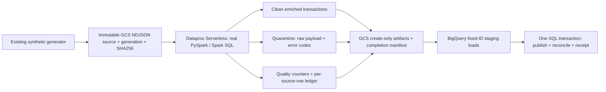

# Dataproc Serverless + BigQuery pilot

Implemented source and offline verification only. **No API, IAM, bucket, dataset,
table or batch was created; no billable workload was executed.** This feature is
independent of draft PRs #2/#3. All original application files, image/source evidence
and recovery receipts remain unchanged. Vertex AI and Cloud Workflows follow later.

## Complete data path



The driver reads **one exact GCS generation**, checks its SHA-256, and enforces
10 MiB / 100,000-row limits before Spark. This is a deliberately bounded pilot,
not a multi-terabyte ingestion implementation. Parsing/output serialization runs
on the driver; normalization, window duplicate detection, routing, amount/date
enrichment and quality aggregation execute as real distributed Spark operations.
The code reuses `synthetic_quality.schema` and the original synthetic generator.
Business predicates express that existing contract in Spark SQL; no pandas UDF or
Python substitute is presented as Spark. Tests compare valid data to the original
pandas validator. The Spark worker package needs only the original schema constants,
not its pandas/sklearn training pipeline.

Input: one UTF-8 JSON object per line, exactly the original seven transaction fields.
Amounts must be JSON numbers, timestamps UTC ISO strings ending in `Z`/`+00:00`.
Missing/extra keys, repeated JSON keys, malformed JSON, wrong types, null/blank
required fields, invalid/nonpositive/nonfinite amounts, bad/non-UTC timestamps,
unsupported categories/countries/currencies and country/currency mismatch route to
quarantine. All members of a duplicate transaction-ID group are quarantined; the
original validator reports duplicates after the first, while this pipeline avoids
choosing an arbitrary surviving record. Blank IDs are invalid, not duplicate keys.
No records are silently repaired or dropped. Invalid UTF-8, hash/generation mismatch,
empty input and size-limit violations stop the run before Spark processing.

Every physical source line has a deterministic row ID and raw-record hash, preserving
duplicate evidence. Clean data includes USD-equivalent amount and UTC date. Each of
12 quality checks counts affected rows (not cells); overlapping counts must not be
summed to infer quarantined records. One source row routes to exactly one outcome.

## Replay and failure semantics

`lakehouse/phase2/runs/RUN_ID/request.json` reserves exact source URI/generation/hash,
configuration, code digest and Spark version. Four create-only NDJSON artifacts
(`clean`, `quarantine`, `quality`, `ledger`) are uploaded with generation preconditions
and byte read-back; `completion.json` is published last. Partial reruns preserve
matching objects. A completed replay verifies their hashes/generations without
starting Spark. Changed inputs/code/settings under the same ID fail; use a reviewed
new ID, never delete/reset receipts. Different run IDs intentionally represent
different experiments; deduplication is **within a logical run**, not across IDs.

BigQuery has three required result tables and a permanent `pipeline_runs` receipt.
Schemas are explicit in `src/synthetic_quality_lakehouse/schemas.py`; schema JSON
exports are in `schemas/`. Dedicated per-run staging tables use `WRITE_EMPTY`, no
autodetection and no bad-record allowance. Empty outputs have empty schema-defined
stages and skip an empty-file load. No target overwrite, deletion or schema repair.
The loader rejects unexpected table ownership/schema/location. Table ownership is
the exact `application=synthetic-quality-lakehouse` label established by reviewed DDL.

Fixed job IDs bind the run, fingerprint, dataset and location. A lost acknowledgement
stops; a later explicit invocation first reads the same job. Existing job configuration
must match. Failed terminal jobs never authorize replacement jobs or automatic retry.
GCS generations/hashes are checked before and after loads. Keep the input/output
prefixes immutable with create/read-only data access; owner overwrite outside this
contract is not supported. Staging tables are retained for evidence, not cleaned up
automatically. No time-based expiry can invalidate a receipt silently.

`sql/publish.sql` transactionally inserts results and a run receipt, rejecting
uncommitted existing rows and conflicting run IDs. `sql/reconcile.sql` uses a FULL
OUTER JOIN to compare source row IDs, raw-record hashes, disposition and amount,
and checks source/target counts and duplicate keys. Failure rolls back publication.
A replay with the same completed job ID submits nothing; if historical job metadata
is unavailable, populated stages conservatively stop instead of duplicating loads.
One operator per logical run is required; preserve BigQuery/GCS history. No claim of
global exactly-once processing across renamed runs, deleted state or out-of-band writers.

## Offline preparation and tests — Codex Cloud / GitHub CI

The new CI uses Python 3.12, Java 21 and actual PySpark 4.0.1, matching the documented
Dataproc runtime 3.0 stack. Its GCS SDK pin 2.19.0 also matches the documented runtime.
Original application CI continues independently with its unchanged constraints.
Do not combine the original constraints files with the feature environment:
BigQuery 3.38 requires `python-dateutil<3`, while the original snapshot pins 3.0.
The isolated feature environment pins 2.9.0.post0; neither original constraints
file nor the verified image is changed.

```bash
test ! -e .venv  # use a fresh feature checkout; preserve existing environments
python3 -m venv .venv
.venv/bin/python -m pip install -e '.[dev]' -r requirements-lakehouse.txt
.venv/bin/python -m pip check
SPARK_LOCAL_IP=127.0.0.1 .venv/bin/python -m pytest \
  -c tests_lakehouse/pytest.ini tests_lakehouse -q
.venv/bin/python -m ruff check src/synthetic_quality_lakehouse tests_lakehouse tools jobs
.venv/bin/python -m ruff format --check src/synthetic_quality_lakehouse tests_lakehouse tools jobs
```

The feature-only pytest configuration filters PySpark's known unclosed-result-socket
ResourceWarning on Python 3.12; other warnings remain errors. Original test settings
are unchanged. Tests execute Spark locally, SQL relational reconciliation in DuckDB
after dialect translation, BigQuery-dialect parsing, and fake GCS/job API boundaries.
They do **not** execute GoogleSQL transactions on BigQuery or Dataproc managed batches.

These commands produce local code/input files only; no cloud calls:

```bash
mkdir -p .tmp/lakehouse
.venv/bin/python tools/package_lakehouse.py .tmp/lakehouse/lakehouse.zip
.venv/bin/python tools/generate_lakehouse_source.py \
  .tmp/lakehouse/pilot-001.ndjson --rows 256 --with-invalid
.venv/bin/python -m synthetic_quality_lakehouse.bigquery ddl \
  --project gcp-intelligent-data-quality --dataset synthetic_quality_lakehouse \
  > .tmp/lakehouse/tables.sql
```

Existing local destinations are never overwritten by the packaging/fixture tools.
Expected fixture: 256 source rows, 252 clean, 4 quarantined (two duplicate members,
one null customer, one negative amount), and 12 quality results. The input hash is
printed. The package ZIP contains only code/SQL/schema constants; no credentials,
receipts, datasets or model artifacts. It is a Dataproc dependency, not a ZIP the
owner must download/upload manually: future approved GCS uploads originate from a
GitHub checkout in Cloud Shell.

## Future managed execution — separate explicit approvals required

Do not run resource-changing examples during this implementation review. The default
CLI `ddl` prints SQL only; `load` requires `--approve-publication`. This is an
acknowledgement gate, not authorization by itself. Dataproc submission remains a
manual, separately approved operation; no submitter or automatic deployment workflow
is added. There is no Cloud Build or container requirement for this feature.

Planned coordinates (all require live compatibility/permission review):

| Resource | Proposed value / boundary |
|---|---|
| Project / region | `gcp-intelligent-data-quality` / `asia-south1` |
| Existing data bucket | `synthetic-quality-984592102391-data-as1`, new `lakehouse/` prefixes only |
| Source | `lakehouse/inputs/pilot-001.ndjson`, exact generation/hash |
| Code | `lakehouse/code/REVIEWED_FEATURE_COMMIT/`, immutable files |
| Outputs | `lakehouse/phase2/runs/pilot-001/` |
| New BQ dataset | `synthetic_quality_lakehouse`, regional `asia-south1` |
| Result tables | `clean_transactions`, `quarantined_records`, `quality_results`, `pipeline_runs` |
| New Spark account | `synthetic-quality-spark@…iam.gserviceaccount.com` |
| New publisher account | `synthetic-quality-bq-loader@…iam.gserviceaccount.com` |
| Batch / request ID | `synthetic-quality-pilot-001` / `1fb96fa9-59bb-47a6-a396-35da37d5460a` |

Before approval: inspect existing resources and require reviewed schemas/labels,
current billing and actual budget, regional Dataproc 3.0 availability/quota, compatible
subnet with Private Google Access and necessary worker connectivity, org/deny/PAB/
VPC SC applicability. Required APIs include `dataproc.googleapis.com`, runtime 3.0's
`dataproc-rm.googleapis.com`, `compute.googleapis.com`, `bigquery.googleapis.com`,
Storage/IAM/Logging and their service agents. **Do not enable or provision them now.**
Cloud Run Mumbai availability does not establish Dataproc readiness.

Future approved IAM: dedicated Spark account's runtime-3.x serverless node role plus
only source/code object read and create/read on new output prefixes; batch operator
limited submission/status and `actAs` on Spark account. Publisher needs project
`bigquery.jobs.create`, scoped table get/create/getData/updateData on the dedicated
dataset and immutable output reads. Do not reuse or broaden existing Run/build SAs
or PR #3 WIF roles. Use attached identities/ADC in GCP without keys; owner CLI reads
may use existing authorized Cloud Shell credentials. Long-lived credentials and
implicit end-user workload identity are not part of the batch plan.

After a separately approved owner creates/validates the regional dataset and executes
the reviewed DDL, code/input objects must be uploaded create-only, recording their
generations and hashes. Do not use an upload command that replaces existing files.
The unrelated `gcp-idq-data-984592102391` bucket is explicitly rejected by the code;
build-source staging and all historical receipts are excluded from this pipeline.

For review, these are the explicit future preparation steps; **none was executed**.
Use a fresh pinned GitHub feature checkout in authenticated Cloud Shell. Inspect
`bq show --format=prettyjson gcp-intelligent-data-quality:synthetic_quality_lakehouse`
first. A permission error is not missing. Only after confirmed absence and separate
resource approval would the owner run:

```bash
bq --project_id=gcp-intelligent-data-quality --location=asia-south1 mk \
  --dataset gcp-intelligent-data-quality:synthetic_quality_lakehouse
bq --project_id=gcp-intelligent-data-quality --location=asia-south1 query \
  --use_legacy_sql=false < .tmp/lakehouse/tables.sql
```

If the dataset/tables exist, inspect their location, schemas and labels before
reuse; do not recreate or alter them to make this example pass. The DDL uses
CREATE IF NOT EXISTS, and the loader independently rejects schema/ownership drift.
Future approved staging from that checkout uses the create-only helper:

```bash
.venv/bin/python tools/stage_lakehouse.py \
  --input .tmp/lakehouse/pilot-001.ndjson --revision "$(git rev-parse HEAD)" \
  --run-id pilot-001 --approve-staging
```

The helper checks the exact clean checkout, uploads only the synthetic input,
deterministic dependency ZIP and driver into new prefixes, and returns source/code
URI, generation and SHA-256 records. Matching replay preserves generations;
conflicts stop. Record these public object references privately with the run
evidence; do not copy credentials or original recovery receipts. It submits no
batch and grants no permissions. Populate the following source/code variables
from this reviewed output, not guessed values.

`batch.example.json` is a reviewable REST body with deliberately unresolved source
hash/generation, code revision and subnet. The equivalent future Cloud Shell command
below has **no defaults for unresolved values** and fails before submission if absent:

```bash
(
  set -eu
  : "${REVIEWED_FEATURE_COMMIT:?Set exact approved feature commit}"
  : "${SOURCE_GENERATION:?Set recorded source generation}"
  : "${SOURCE_SHA256:?Set recorded source SHA-256}"
  : "${REVIEWED_SUBNET:?Set approved full regional subnet resource name}"
  gcloud dataproc batches submit pyspark \
    "gs://synthetic-quality-984592102391-data-as1/lakehouse/code/${REVIEWED_FEATURE_COMMIT}/dataproc_quality.py" \
    --project=gcp-intelligent-data-quality --region=asia-south1 --version=3.0 \
    --batch=synthetic-quality-pilot-001 \
    --request-id=1fb96fa9-59bb-47a6-a396-35da37d5460a \
    --service-account=synthetic-quality-spark@gcp-intelligent-data-quality.iam.gserviceaccount.com \
    --user-workload-authentication-type=SERVICE_ACCOUNT --subnet="$REVIEWED_SUBNET" \
    --ttl=10m --async \
    --py-files="gs://synthetic-quality-984592102391-data-as1/lakehouse/code/${REVIEWED_FEATURE_COMMIT}/lakehouse.zip" \
    --properties=dataproc.tier=standard,spark.driver.cores=4,spark.driver.memory=8g,spark.executor.cores=4,spark.executor.memory=8g,spark.executor.instances=2,spark.dynamicAllocation.enabled=false,spark.sql.shuffle.partitions=2,spark.sql.session.timeZone=UTC \
    -- --source-uri=gs://synthetic-quality-984592102391-data-as1/lakehouse/inputs/pilot-001.ndjson \
    --source-generation="$SOURCE_GENERATION" --source-sha256="$SOURCE_SHA256" \
    --output-uri=gs://synthetic-quality-984592102391-data-as1/lakehouse/phase2 --run-id=pilot-001
)
```

Runtime 3.0 does not use the old Dataproc staging bucket; do not add a legacy staging
bucket flag. Inspect a pre-existing batch with that ID rather than resubmit/rename
after ambiguous acknowledgement. Do not automatically retry a failed batch. The TTL
limits lifetime, not spend. This minimum configuration is **12 vCPUs** across a
driver and two executors, 24 GiB heap plus overhead and service-managed disks; it is
not the existing 1-vCPU Run smoke. Startup dominates tiny-data cost. No ₹100 cost
guarantee applies. Storage, BigQuery DML/query and retained evidence may be charged.

Read status after the approved submission:

```bash
gcloud dataproc batches describe synthetic-quality-pilot-001 \
  --project=gcp-intelligent-data-quality --region=asia-south1 --format=json
gcloud storage cat \
  gs://synthetic-quality-984592102391-data-as1/lakehouse/phase2/runs/pilot-001/completion.json
```

Require batch SUCCEEDED and the manifest's exact source/code identity, 256 ledger
rows, 252 clean, 4 quarantine and 12 checks. Only then, after separate publication
approval, use the approved publisher identity in Cloud Shell to load:

```bash
python3 -m synthetic_quality_lakehouse.bigquery load \
  --project=gcp-intelligent-data-quality --dataset=synthetic_quality_lakehouse \
  --location=asia-south1 \
  --manifest-uri=gs://synthetic-quality-984592102391-data-as1/lakehouse/phase2/runs/pilot-001/completion.json \
  --approve-publication
```

Use an isolated Cloud Shell Python environment with this feature installed, not the
old recovery environment; do not run Spark or the ML pipeline on the laptop. The
publisher uses the explicitly provided existing ADC identity; the proposed publisher
SA is not automatically impersonated. Credential/identity setup is a later approved
operator step, not handled by this implementation.

Require a completed publish job and one permanent receipt; 252 clean / 4 quarantine /
12 quality rows, zero unmatched/duplicate ledger keys and matching amounts/hashes.
BigQuery's transaction includes reconciliation before commit; `sql/reconcile.sql`
can also be rendered with the exact stage table ID for a separately approved query.
Queries can be billed; they are not included in read-only infrastructure approval.
The loader sets a 100 MB per-query billed-byte ceiling, not a total spending cap.

Failure before completion: no BigQuery publication. Failed load: no publish job.
Failed SQL assertion: BigQuery rolls back target inserts and receipt; retain stages
and job error for investigation. Lost acknowledgement: inspect the fixed job first,
then obtain explicit approval for invoking recovery; no new ID or automatic retry.
Rollback is prevention/transaction rollback, not deletion of unrelated data. No
cleanup is automatic. Any eventual deletion must inventory and approve only these
exact new prefixes/stages/dataset; preserve original evidence and existing resources.

References reviewed: [runtime 3.0](https://docs.cloud.google.com/managed-spark/docs/concepts/versions/spark-runtime-3.0),
[batch flags](https://docs.cloud.google.com/sdk/gcloud/reference/dataproc/batches/submit/pyspark),
[resource limits](https://docs.cloud.google.com/managed-spark/docs/concepts/spark-properties-serverless),
[runtime identities](https://docs.cloud.google.com/managed-spark/docs/concepts/personas-and-serverless-iam-roles),
[BigQuery transactions](https://docs.cloud.google.com/bigquery/docs/transactions).
